# Carbon-Aware Kubernetes Batch Scheduler

[](https://github.com/sonujha78/carbon-aware-scheduler/actions/workflows/ci.yml)


A Kubernetes controller that **delays batch jobs while the electricity grid is dirty, runs them when it is cleaner, and never misses a deadline.** A Grafana dashboard shows the grid intensity, the waiting jobs and the CO2 avoided.

<p align="center">
  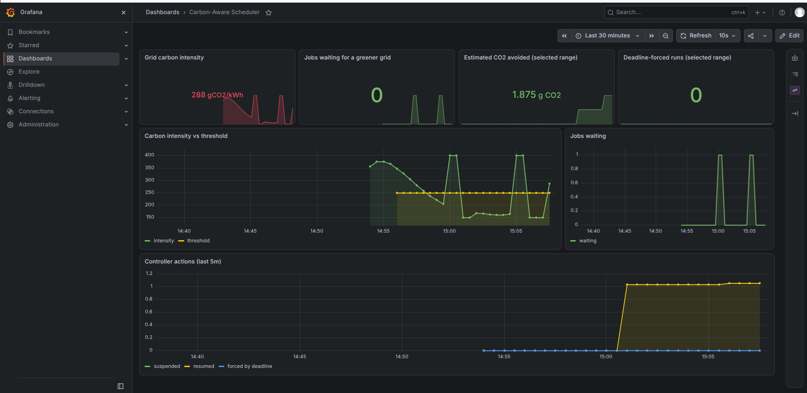
</p>

## Table of contents

- [Goal](#goal)
- [Architecture](#architecture)
- [How a job opts in](#how-a-job-opts-in)
- [How it was built, step by step](#how-it-was-built-step-by-step)
- [Results](#results)
- [Problems met and how they were fixed](#problems-met-and-how-they-were-fixed)
- [Quick start](#quick-start)
- [CarbonPolicy](#carbonpolicy)
- [Metrics](#metrics)
- [Tests and CI](#tests-and-ci)
- [Project structure](#project-structure)
- [Limitations and next steps](#limitations-and-next-steps)
- [Clean up](#clean-up)

## Goal

Batch jobs such as backups, report generation, log compaction and ML training usually run on a fixed schedule, even when the electricity grid is at its most carbon-intensive. Many of these jobs are not urgent. If they can wait a few hours, the same work emits less CO2 when the grid is greener.

Kubernetes has no idea how clean the grid is, so it cannot make that trade-off on its own. This project adds that missing awareness:

1. Read the current grid carbon intensity (gCO2/kWh).
2. Suspend opted-in jobs while the grid is dirty.
3. Resume them when the grid is clean.
4. Always let a job run if waiting longer would miss its deadline.
5. Expose metrics and a dashboard that prove how much CO2 was avoided.

Everything runs locally on a laptop with kind, so there is no cloud cost.

## Architecture

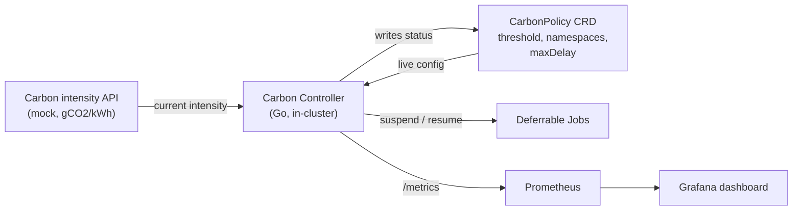

### Decision logic (every 10 seconds)

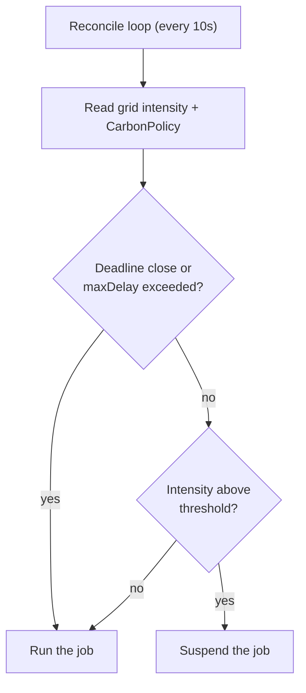

## How a job opts in

| Field | Where | Meaning |
|---|---|---|
| `green.devops/deferrable: "true"` | label | Opt the Job in. Nothing else is touched. |
| `green.devops/deadline` | annotation | RFC3339 time by which the job must have finished. |
| `green.devops/estimated-runtime` | annotation | Used for the deadline check and the CO2 estimate, for example `1m`. |
| `green.devops/power-watts` | annotation | Power draw used for the CO2 estimate. |

CO2 avoided = (intensity when first seen - intensity at resume) x power in kW x runtime in hours.
Example: (400 - 150) x 0.15 kW x (1/60) h = **0.625 g**.

## How it was built, step by step

Every step was built, tested on a local kind cluster and pushed to GitHub before moving on, so the commit history tells the same story.

### Step 1: GitHub repository

- **What:** A public repository with a description, MIT license, README and topics (kubernetes, golang, prometheus, grafana, helm, devops, greenops, sustainability).
- **Why:** Recruiters look at GitHub first. A clear name, description and topics make the project easy to find and understand in seconds.
- **Result:** Repository created and cloned. All later work was committed in small, meaningful steps.

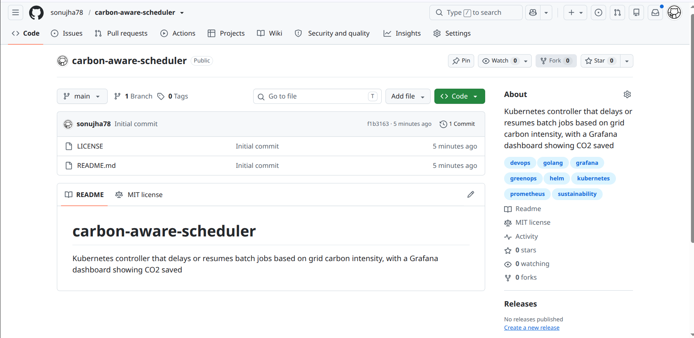

### Step 2: Mock carbon intensity API

- **What:** A small Go HTTP service. `/intensity` returns the current gCO2/kWh from a simulated 24-hour curve (low at night, a solar dip at midday, an evening peak). One simulated hour lasts 60 real seconds, so a full day replays in 24 minutes. `/set?value=400` forces a value and `/set?value=reset` returns to the curve.
- **Why:** Real carbon APIs need keys and change slowly, which makes demos and tests unpredictable. A mock gives full control: dirty grid, clean grid or a fast-moving day, on demand.
- **Result:** Verified with curl: the curve value came back (177.1), the override worked (400) and reset worked. The same service is used by the controller, the demo and the CI end-to-end test.
- **Commit:** `feat(mock-api): add mock carbon intensity API with 24h curve`

### Step 3: Docker image and kind cluster

- **What:** A multi-stage Dockerfile (Go build stage, small Alpine runtime), a Deployment and Service in the `carbon-system` namespace, and a local kind cluster named `carbon-demo`.
- **Why:** Running the mock API inside the cluster mirrors how a real service would be reached (`mock-carbon-api.carbon-system.svc`). kind keeps everything on the laptop.
- **Result:** The pod reached Running (1/1) and answered `/intensity` from inside the cluster. The simulated hour matched the pod's age, which confirmed the answer came from the pod and not from the local process.
- **Commit:** `feat(deploy): dockerize mock API and add k8s manifests`

### Step 4: Monitoring stack (Prometheus and Grafana)

- **What:** kube-prometheus-stack installed with Helm using a lean values file: Alertmanager and node-exporter disabled, 2-day retention, a memory limit on Prometheus and the Grafana dashboard sidecar enabled.
- **Why:** The laptop already runs other projects, so the stack was kept small. The sidecar loads dashboards from a ConfigMap, which keeps the dashboard in Git instead of clicked together by hand.
- **Result:** All pods Running and the default Kubernetes dashboards visible in Grafana.
- **Commit:** `feat(monitoring): add lean kube-prometheus-stack values`

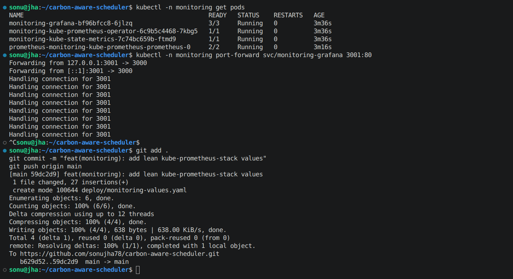

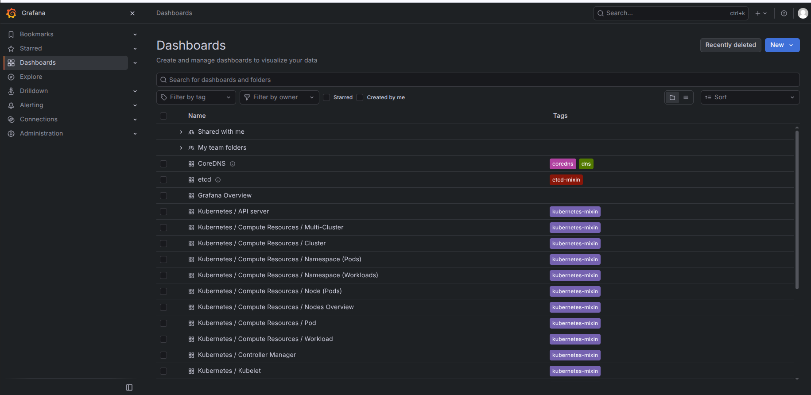

### Step 5: The controller (core logic)

- **What:** A Go controller with a reconcile loop that runs every 10 seconds. It reads the grid intensity, lists Jobs labelled `green.devops/deferrable=true` and sets `spec.suspend` accordingly. A job whose deadline is too close is resumed even on a dirty grid. When a job resumes, the avoided CO2 is estimated and recorded. Prometheus metrics are exposed on `/metrics`.
- **Why:** Suspending and resuming Jobs is the smallest change that actually shifts work in time. The deadline rule turns a nice idea into something safe to run: carbon savings must never break an SLO.
- **Result:** All behaviours were tested on the cluster. On a dirty grid (400) the job stayed Suspended. When the grid dropped to 150, the controller logged RESUME with about 0.625 g CO2 avoided and the job ran to Complete. A job with a near deadline was force-run while the grid was still dirty. Running jobs were suspended when the grid turned dirty.
- **Commit:** `feat(controller): carbon-aware Job suspend/resume with deadline safety and metrics`

Dirty grid (400): the deferrable job stays Suspended.

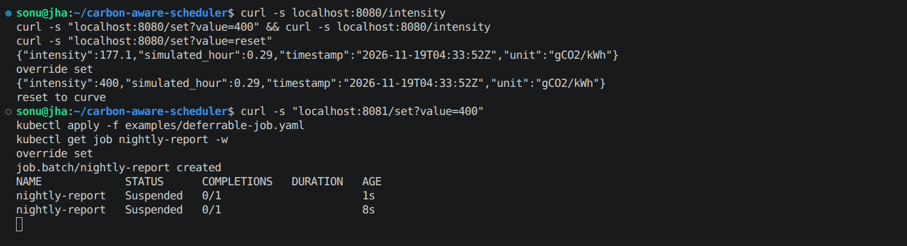

Controller log on the dirty grid: `dirty=true`, `waiting=1`.

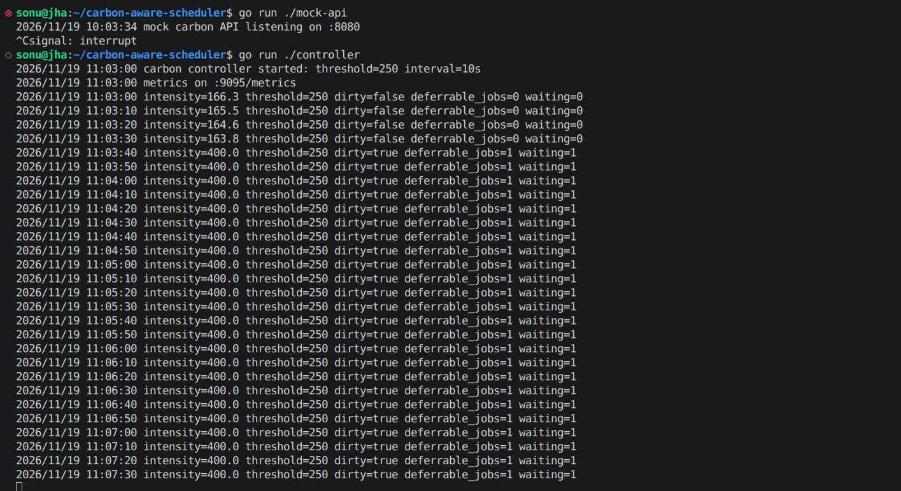

Grid drops to 150: the controller logs RESUME (baseline 400, about 0.625 g CO2 avoided).

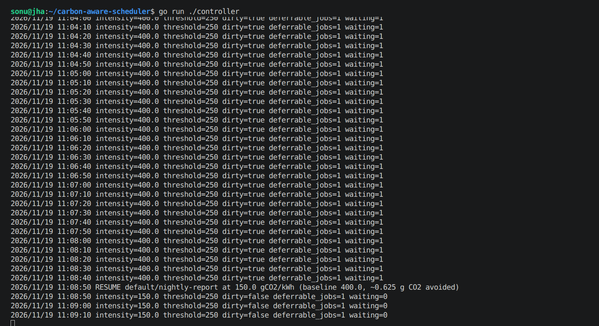

The same moment on the job: Suspended, then Running, then Complete.

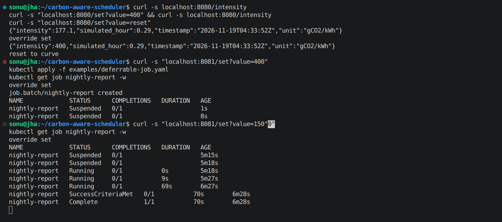

Metrics after the tests: 1 deadline-forced run, 1 suspend, 2 resumes, 0.625 g CO2 avoided.

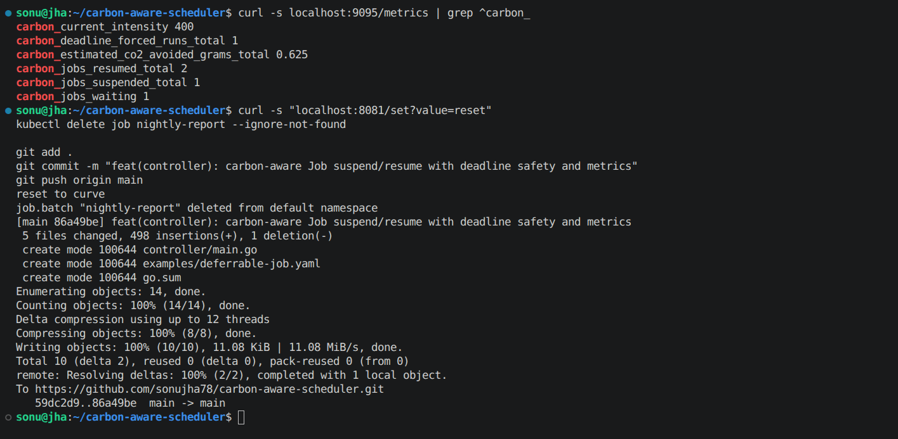

### Step 6: CarbonPolicy custom resource (CRD)

- **What:** A cluster-scoped `CarbonPolicy` CRD with `thresholdGramsPerKwh`, `namespaces` and `maxDelayHours`. The controller reads it through the dynamic client on every loop, falls back to command-line flags if no policy exists, and writes the live state (intensity, dirty, waiting jobs) back to the policy status.
- **Why:** Configuration should not need a code change or a restart. A CRD also makes the project a real operator: behaviour is declared in Kubernetes objects and the controller reconciles towards them.
- **Result:** The log switched from `(flags)` to `(crd)`. Patching the threshold from 250 to 150 made the running job suspend within 10 seconds, with no restart.
- **Commit:** `feat(crd): add CarbonPolicy CRD with live config and status`

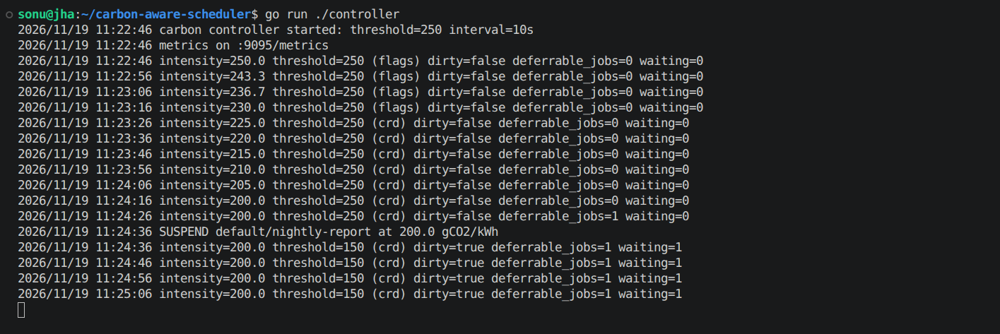

### Step 7: Run the controller inside the cluster

- **What:** A Dockerfile for the controller (non-root user), a ServiceAccount, a ClusterRole with only the permissions it needs (jobs, carbonpolicies and their status), a Deployment with a read-only root filesystem and resource limits, a Service, and a ServiceMonitor so Prometheus scrapes it.
- **Why:** This is how an operator runs in real life. Least-privilege RBAC and a locked-down pod are what reviewers look for.
- **Result:** The in-cluster controller behaved exactly like the local one. `kubectl get carbonpolicy` showed threshold, intensity, dirty and waiting, and a Prometheus query for `carbon_current_intensity` returned data from the controller pod.
- **Commit:** `feat(deploy): run controller in-cluster with RBAC and ServiceMonitor`

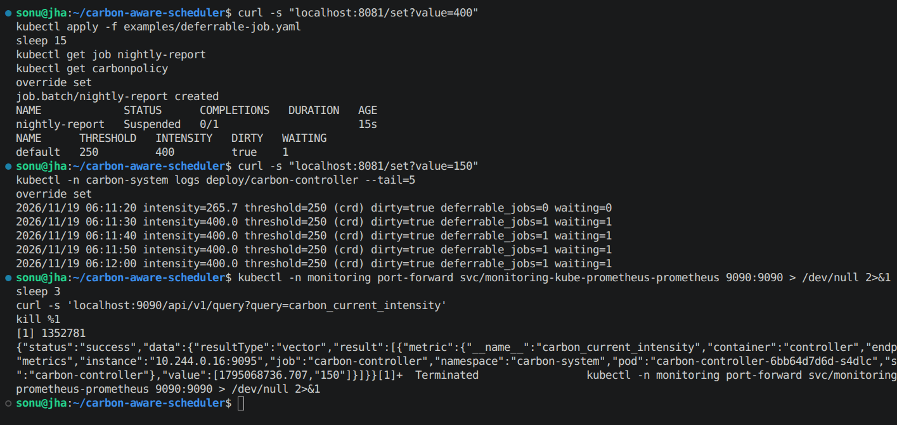

### Step 8: Grafana dashboard

- **What:** A dashboard stored in Git as JSON and loaded from a ConfigMap. It shows grid intensity against the threshold, jobs waiting, controller actions, deadline-forced runs and the estimated CO2 avoided.
- **Why:** The dashboard is the proof. Anyone can see it in ten seconds: the grid gets dirty, jobs wait, the grid gets clean, jobs run and the savings add up.
- **Result:** After the demo the dashboard showed intensity falling from 400 to 150 and jobs waiting dropping from 1 to 0. The CO2 panel showed 1.875 g for three demo runs of 0.625 g each.
- **Commit:** `feat(dashboard): add Grafana dashboard and threshold metric`


### Step 9: Tests and CI

- **What:** Six unit tests with a fake Kubernetes client (dirty grid suspends, clean grid leaves a job alone, resume records avoided CO2, near deadline forces a run, far deadline keeps waiting, maxDelay forces a run). An end-to-end script, and a GitHub Actions workflow that runs gofmt, vet and tests, then builds both images, creates a kind cluster, deploys everything and runs the end-to-end script.
- **Why:** Tests make the project trustworthy. Running the full flow on a fresh cluster in CI proves the quick start works for anyone, not only on this laptop.
- **Result:** The first CI run passed in 4 minutes 51 seconds.
- **Commit:** `ci: add unit tests, e2e script and GitHub Actions workflow`

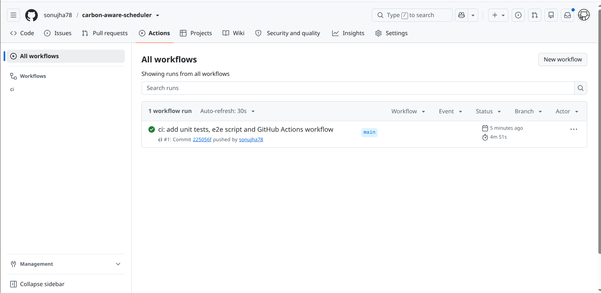

## Results

| Check | Outcome |
|---|---|
| Dirty grid, deferrable job | Stays Suspended |
| Grid becomes clean | Resumes within one loop (10 s) and completes |
| Deadline close on a dirty grid | Forced to run, counted in `carbon_deadline_forced_runs_total` |
| Running job when the grid turns dirty | Suspended within 10 s |
| Threshold changed with `kubectl patch` | Applied live, no restart |
| CO2 estimate for the demo job | 0.625 g per run (1.875 g over three runs) |
| Unit tests | 6 passing, race detector enabled in CI |
| End-to-end test on kind in CI | Passing, 4 min 51 s in total |

## Problems met and how they were fixed

| Problem | Cause | Fix |
|---|---|---|
| Port 8080 already in use during the cluster test | The local `go run` process was still running | Stopped it and used a different local port for port-forward |
| Dashboard panels showed three values each | Each controller restart creates a new pod, so Prometheus holds one series per pod | Wrapped queries in `max()` and `sum(max_over_time(...))` |
| CO2 counter looked like it reset to zero | Counters restart from 0 when the controller pod restarts | Summed the maximum per pod over the selected range |
| CI cluster has no Prometheus | ServiceMonitor is a CRD from the monitoring stack | Moved the ServiceMonitor to its own file so CI deploys only what it needs |

## Quick start

You need Docker, kind, kubectl, Helm and Go 1.22.

```bash
# 1. Cluster and images
kind create cluster --name carbon-demo
docker build -f mock-api/Dockerfile -t carbon-mock-api:dev .
docker build -f controller/Dockerfile -t carbon-controller:dev .
kind load docker-image carbon-mock-api:dev --name carbon-demo
kind load docker-image carbon-controller:dev --name carbon-demo

# 2. CRD, mock API, controller and policy
kubectl apply -f crds/carbonpolicy.yaml
kubectl apply -f deploy/mock-api.yaml
kubectl apply -f deploy/controller.yaml
kubectl apply -f examples/carbonpolicy.yaml

# 3. Monitoring (optional, needed for the dashboard)
helm repo add prometheus-community https://prometheus-community.github.io/helm-charts
helm install monitoring prometheus-community/kube-prometheus-stack \
  -n monitoring --create-namespace -f deploy/monitoring-values.yaml --wait
kubectl apply -f deploy/servicemonitor.yaml
kubectl apply -f deploy/dashboard-configmap.yaml
kubectl -n monitoring port-forward svc/monitoring-grafana 3001:80
# open http://localhost:3001  (admin / admin, local demo only)
```

Try it:

```bash
kubectl -n carbon-system port-forward svc/mock-carbon-api 8081:80 &

# Dirty grid: the job stays suspended
curl -s "localhost:8081/set?value=400"
kubectl apply -f examples/deferrable-job.yaml
kubectl get job nightly-report

# Clean grid: the controller resumes it and records the CO2 avoided
curl -s "localhost:8081/set?value=150"
kubectl -n carbon-system logs deploy/carbon-controller --tail=5

# Change the threshold live
kubectl patch carbonpolicy default --type merge -p '{"spec":{"thresholdGramsPerKwh":150}}'
kubectl get carbonpolicy

# Back to the simulated 24 hour curve
curl -s "localhost:8081/set?value=reset"
```

## CarbonPolicy

```yaml
apiVersion: green.devops/v1alpha1
kind: CarbonPolicy
metadata:
  name: default
spec:
  thresholdGramsPerKwh: 250   # suspend above this
  namespaces: ["default"]     # empty means all namespaces
  maxDelayHours: 6            # force a run after waiting this long
```

The controller writes the live state back to `status` (intensity, dirty, waiting jobs).

## Metrics

| Metric | Type | Meaning |
|---|---|---|
| `carbon_current_intensity` | gauge | Current grid intensity, gCO2/kWh |
| `carbon_policy_threshold` | gauge | Active threshold |
| `carbon_jobs_waiting` | gauge | Deferrable jobs currently suspended |
| `carbon_jobs_suspended_total` | counter | Jobs suspended |
| `carbon_jobs_resumed_total` | counter | Jobs resumed |
| `carbon_deadline_forced_runs_total` | counter | Runs forced by a deadline |
| `carbon_estimated_co2_avoided_grams_total` | counter | Estimated grams of CO2 avoided |

## Tests and CI

```bash
go test ./... -race -count=1     # unit tests, no cluster needed
./tests/e2e.sh                   # needs the quick start deployed
```

GitHub Actions runs gofmt, vet and unit tests, then builds the images, creates a kind cluster and runs the end-to-end script on every push.

## Project structure

```
controller/     Go controller (reconcile loop, policy, metrics, tests)
mock-api/       Mock carbon intensity API with a 24 hour curve
crds/           CarbonPolicy CustomResourceDefinition
deploy/         Controller, mock API, ServiceMonitor, monitoring values, dashboard
dashboards/     Grafana dashboard JSON
examples/       Sample deferrable Job and CarbonPolicy
tests/          End-to-end script
docs/           Screenshots and the PDF version of this report
```

## Limitations and next steps

- Suspending a running Job deletes its pods, so progress is lost. Use this for restart-safe jobs, or create them suspended.
- Carbon data is simulated. The next step is a real source such as Electricity Maps or the UK Carbon Intensity API.
- Single replica, no leader election yet.
- Works on `Job` objects only. `CronJob` support is a natural extension.
- Counters reset when the controller restarts, which is why the dashboard sums over the selected range.

## Clean up

```bash
kind delete cluster --name carbon-demo
docker rmi carbon-mock-api:dev carbon-controller:dev
```

## Also available as PDF

The same report as a single file: [docs/project-report.pdf](docs/project-report.pdf).

## License

MIT
